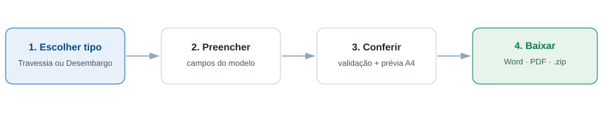

# Gerador de Documentos CEMIG

Aplicação web interna para gerar documentos técnicos da CEMIG a partir de formulários.
Basta escolher o tipo — **Travessia** ou **Desembargo** — preencher os dados e baixar o
documento pronto em **Word (.docx)** e **PDF**, com o mesmo conteúdo.



## O que ele faz

- **Seleção do tipo de documento** na própria tela (Travessia ou Desembargo).
- **Formulário gerado a partir do modelo**: cada tipo tem seus próprios campos,
  agrupados por assunto (Controle, Interessado, Empreendimento, Prazos…).
- **Pré-visualização ao vivo** em formato de folha A4, atualizada enquanto você digita.
  Campos obrigatórios ainda em branco aparecem sublinhados.
- **Validação de verdade**: CPF/CNPJ com dígito verificador, e-mail, telefone, datas
  coerentes (conclusão não pode ser antes do início) e obrigatoriedade por campo.
- **Cálculos automáticos**: prazo em dias a partir das datas, m² → hectares,
  formatação brasileira de números e valores.
- **Download nos dois formatos**, isolados ou em um único `.zip`.
- **Geração em lote**: cole uma lista JSON (ou use `gerar.py lote`) e receba um `.zip`
  com todos os documentos.
- **Modelos em JSON**: para trocar o texto oficial basta editar `modelos/*.json`,
  sem mexer em código.

## Como rodar

Pré-requisito: Python 3.10+.

```bash
./run.sh               # cria o .venv, instala as dependências e sobe o servidor
```

Ou manualmente:

```bash
python3 -m venv .venv
.venv/bin/pip install -r requirements.txt
.venv/bin/python app.py
```

Abra <http://localhost:8000>. Para usar outra porta: `PORT=9000 ./run.sh`.

> O servidor embutido do Flask é suficiente para uso individual/na rede interna.
> Para publicar em produção, rode atrás de um WSGI (`gunicorn app:app`).

## Estrutura

```
app.py                 Rotas web e API (Flask)
gerador/
  util.py              CPF/CNPJ, datas, números, valores por extenso, máscaras
  modelos.py           Leitura dos JSONs, validação, cálculos e montagem dos blocos
  docx_render.py       Desenho do documento em Word (python-docx)
  pdf_render.py        Desenho do documento em PDF (ReportLab)
  html_preview.py      Pré-visualização (mesmos blocos, em HTML)
  gerar.py             Fachada: gerar_documentos, gerar_zip, gerar_lote
  cli.py               Linha de comando (geração individual e em lote)
modelos/
  travessia.json       Formulário + texto do termo de travessia
  desembargo.json      Formulário + texto do requerimento de desembargo
templates/index.html   Tela única (formulário + prévia)
static/                Estilos e lógica da interface
tests/                 Testes automatizados do núcleo e da API
assets/                Logo (opcional) — veja assets/LEIA-ME.txt
exemplos/lote.json     Exemplo de lote para geração em massa
```

## Personalizando os modelos

Cada arquivo em `modelos/` descreve **o formulário** (`campos`) e **o documento**
(`secoes`). Não é preciso programar: os renderizadores leem esses blocos.

### Campos

```json
{
  "chave": "tensao_kv",
  "rotulo": "Tensão nominal (kV)",
  "tipo": "numero",
  "grupo": "Travessia",
  "obrigatorio": true,
  "sufixo": " kV"
}
```

| `tipo`      | Comportamento                                                      |
|-------------|--------------------------------------------------------------------|
| `texto`     | Texto livre.                                                        |
| `numero`    | Aceita `13,8` ou `13.8`; formata no padrão brasileiro.              |
| `data`      | Calendário; sai como `dd/mm/aaaa`.                                  |
| `documento` | CPF ou CNPJ com máscara e validação de dígito.                      |
| `telefone`  | Máscara `(00) 00000-0000`.                                          |
| `email`     | Validação de formato.                                               |
| `selecao`   | Lista fechada em `opcoes` (use `padrao` para pré-selecionar).       |
| `area`      | Texto multilinha; cada linha vira um item de lista no documento.    |

Outras propriedades: `obrigatorio`, `padrao`, `dica`, `placeholder`, `largo`,
`casas_decimais`, `sufixo` e `calculado` (`dias_entre` ou `m2_para_ha`, com `origem`).

### Blocos do documento

| Bloco           | Uso                                                          |
|-----------------|--------------------------------------------------------------|
| `p`             | Parágrafo corrido.                                            |
| `lista`         | Lista marcada.                                                |
| `clausula`      | Título em negrito + texto justificado.                        |
| `tabela_campos` | Tabela rótulo/valor; campos vazios são omitidos.              |
| `lista_campo`   | Lista a partir de um campo multilinha.                        |
| `condicional`   | Só renderiza o conteúdo se o campo estiver preenchido.        |

### Escrevendo o texto

Nos textos use `{{campo}}` para inserir um valor já formatado e `{{campo|filtro}}`
para um formato específico:

| Filtro        | Resultado                                              |
|---------------|--------------------------------------------------------|
| `cpfcnpj`     | `111.444.777-35` / `11.222.333/0001-81`               |
| `data`        | `03/11/2026`                                           |
| `data_extenso`| `3 de novembro de 2026`                                |
| `numero`      | `13,8` (padrão brasileiro, sem zeros à toa)            |
| `moeda`       | `R$ 1.234,50`                                          |
| `extenso`     | `dois mil e vinte e seis`                              |
| `maiusculo`   | `TEXTO`                                                |
| `minusculo`   | baixa só a primeira letra (preserva nomes e siglas)    |
| `titulo`      | `Texto Em Caixa Alta Nas Iniciais`                     |

Trechos opcionais podem ser envolvidos em condicional inline, evitando sobras como
`nº` solto quando o campo está vazio:

```text
Anotação de Responsabilidade Técnica — ART/RRT{{?art_numero}} nº {{art_numero}}{{/art_numero}};
```

### Acrescentar um novo tipo de documento

Crie `modelos/meu-tipo.json` seguindo a estrutura dos existentes. Ele aparece
automaticamente no seletor da tela e nos endpoints da API — nenhuma alteração de
código é necessária.

## Linha de comando

```bash
# um documento, a partir de um JSON de dados
.venv/bin/python -m gerador.cli gerar travessia --dados exemplos/travessia.json --saida saida/

# vários documentos de uma vez
.venv/bin/python -m gerador.cli lote exemplos/lote.json --saida saida/

# listar modelos e campos disponíveis
.venv/bin/python -m gerador.cli modelos
```

## API

| Rota                     | Método | Descrição                                             |
|--------------------------|--------|-------------------------------------------------------|
| `/api/modelos`           | GET    | Lista os modelos com campos e grupos.                  |
| `/api/modelos/<id>`      | GET    | Detalhe de um modelo.                                 |
| `/api/previa`            | POST   | Prévia em HTML (não exige validação completa).        |
| `/api/validar`           | POST   | Valida sem gerar arquivo.                             |
| `/api/gerar`             | POST   | Gera `docx`, `pdf` ou `zip`.                          |
| `/api/lote`              | POST   | Gera vários registros em um `.zip`.                   |

Exemplo:

```bash
curl -X POST http://localhost:8000/api/gerar \
  -H 'Content-Type: application/json' \
  -d '{"modelo":"desembargo","formato":"zip","dados":{"data_documento":"2026-11-03",
       "interessado_nome":"Agropecuária Santa Rita Ltda.","interessado_documento":"11222333000181",
       "empreendimento":"Fazenda Santa Rita","municipio":"Três Corações","auto_embargo":"AE 012345/2025",
       "data_embargo":"2025-08-14","area_m2":"125000","responsavel_nome":"Carlos Pereira",
       "responsavel_registro":"CREA-MG 654321/D"}}' \
  -o desembargo.zip
```

Erros de validação voltam com HTTP 422 e o mapa campo → mensagem:

```json
{"erro": "Confira os campos destacados.", "erros": {"auto_embargo": "Campo obrigatório."}}
```

## Logo e identidade visual

Sem imagem em `assets/`, o cabeçalho usa a marca tipográfica “CEMIG”. Para usar a
logo oficial, salve o arquivo como `assets/logo.png` (ou `.jpg`) — ela entra
automaticamente no Word e no PDF.

## Testes

```bash
.venv/bin/python -m unittest discover -s tests -v
```

Cobrem formatação (CPF/CNPJ, datas, extenso), validação, cálculos, montagem dos
blocos, geração real de `.docx`/`.pdf`/`.zip` e todas as rotas da API.

## Avisos importantes

- Os textos em `modelos/*.json` são **modelos provisórios**, escritos com os campos
  e cláusulas típicos. Substitua-os pelos textos oficiais antes do uso em produção.
- O app não guarda dados de clientes: os documentos são gerados em memória e enviados
  na hora; nada é gravado em disco pelo servidor.
- A pasta `saida/`, os arquivos `.docx/.pdf/.zip` e a logo local estão no `.gitignore`.
